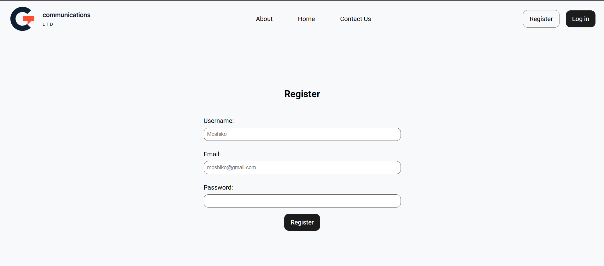
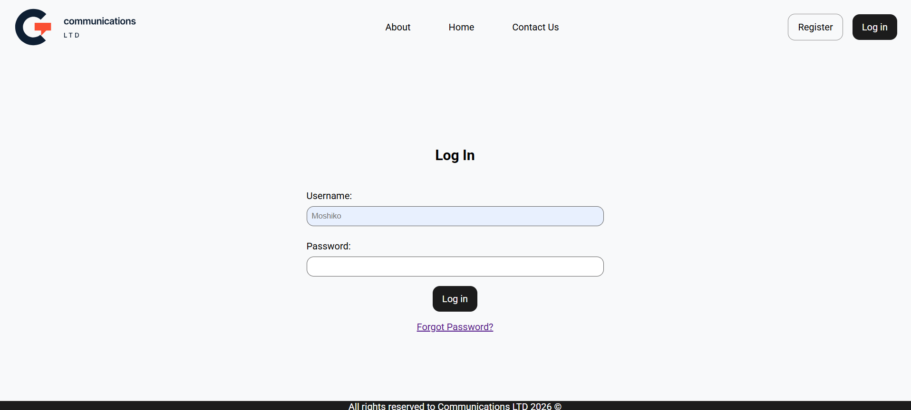
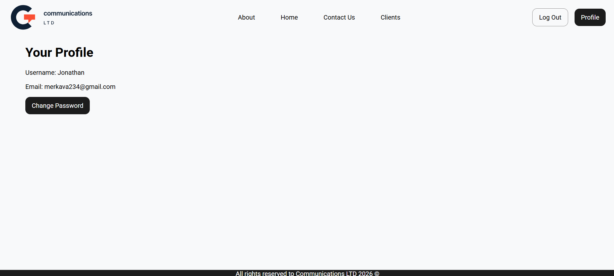
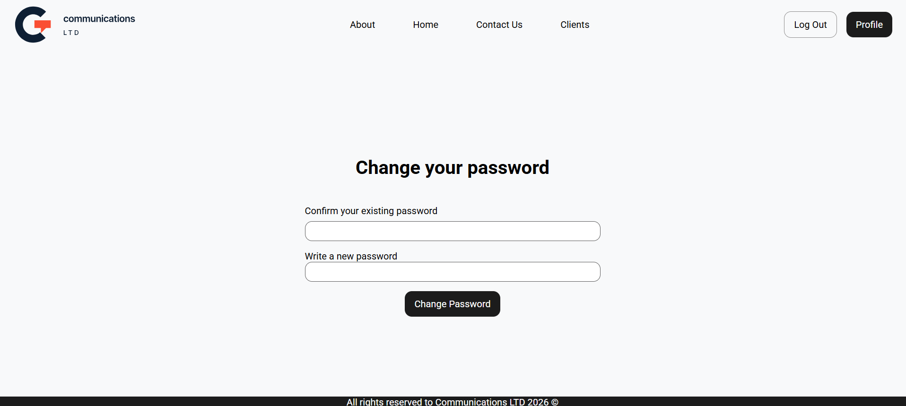
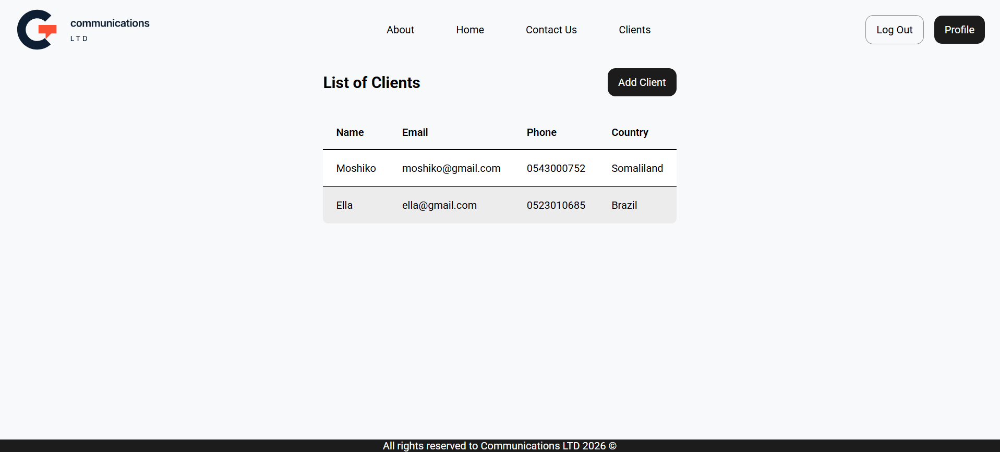
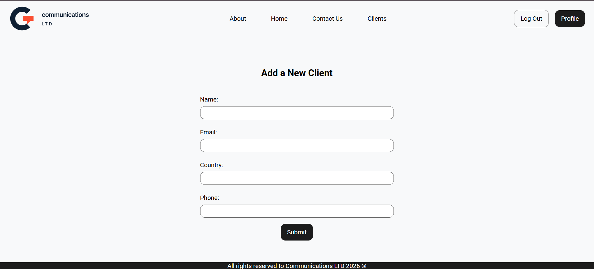
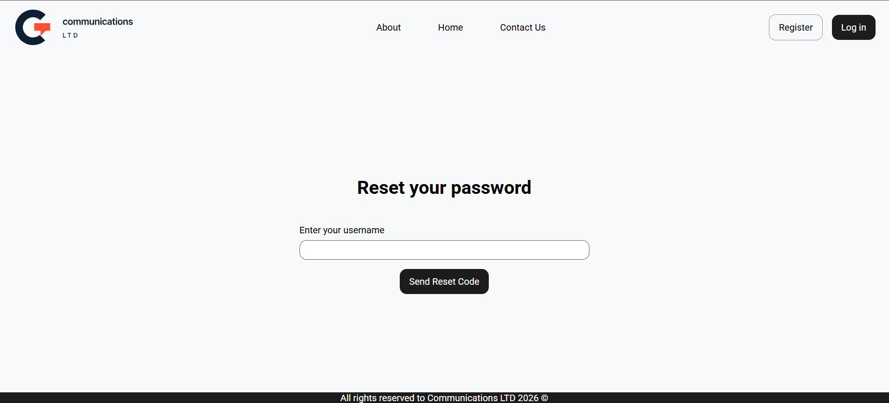
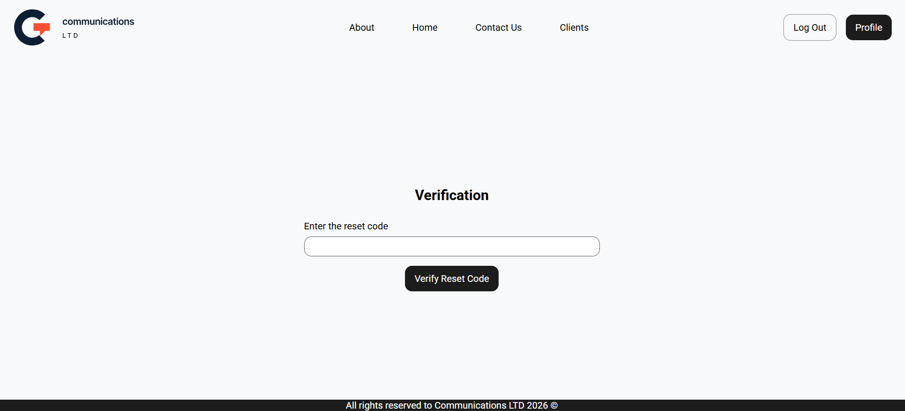
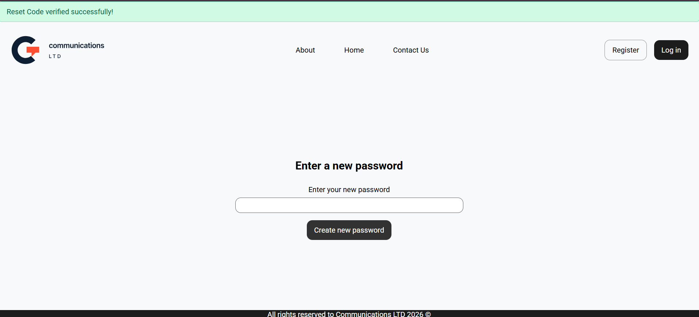

# Communications LTD (Safe version)

<small> Note: I really didn't use AI for this file, so I could better defend the project</small>


This project presents a demo website of an imaginary company named 'Communications LTD'.


According to the requirements, it supports several features:
1. Register - Create a new account with a username, e-mail and password.
2. Change Password - Change the password
3. Login - Log in with username and password. Basic Rate limiting and password checks implemented.
4. Basic Client Management System - View a list of clients, add new ones.
5. 'Forget Password' - sends an E-mail to reset the password


We will review installation and usage first, and then review the main files and security mechanisms implemented in this project to prevent attacks such as SQL Injections and Stored XSS.


## Installation & Usage
Currently this project is not shipped with Docker, so follow these steps.
First, Download the project from GitHub. Then make sure you have PostgreSQL installed and running. 
Then manage the configurations in `config.py` and create a new `.env` file as will be described in the next sections.

After you fill out all the relevant details, run the following command in the root directory:

```bash 
python run.py
```

## Configurations
The main configurations are found in `app/config.py`.

`SQLALCHEMY_DATABASE_URI` - The connection string with the PostgreSQL database.
For example: 
```
postgresql+psycopg://postgres:<your-password>@localhost:5432/mydb
```

`HMAC_SECRET_KEY` - A secret key that will be loaded from the .env file, for the password hashing process with the hmac module.


`SECRET_KEY` - A secret key that flask expects. Flask uses this to create a signature for sessions. That way, it can know whether sessions were manipulated by a third party. It has further usages with secure CSRF tokens, but that's out of the scope of this course.


`RESET_CODE_HMAC_KEY` - A separate hmac key for the hashing, specifically when resetting or changing a password.


Password validation rules:
```python
PASSWORD_MIN_LENGTH = 10
PASSWORD_REQUIRE_UPPERCASE = True
PASSWORD_REQUIRE_LOWERCASE = True
PASSWORD_REQUIRE_DIGIT = True
PASSWORD_REQUIRE_SPECIAL = True
PASSWORD_HISTORY = 3
DICTIONARY_CHECK_ENABLED = True

```
These are set in accordance with the project's requirements.


Login rate limiting:

```python
FAILED_LOGIN_LIMIT = 3
FAILED_LOGIN_TIMEOUT_MINUTES = 5
```

The .env file should be in the following format:

```python
DATABASE_URL = ...
HMAC_SECRET_KEY = ...
FLASK_SECRET_KEY = ...
SMTP_EMAIL = ...
SMTP_PASSWORD = ...
RESET_CODE_HMAC_KEY= ...
```

Copy it into your machine and replace the `...` with your personal sensitive data.


## Project Structure
```
app/
    static/
        css/
        assets/
        js/
    utils/
    templates/
    data/
    __init__.py
    models.py
    routes.py
    validators.py
.env
config.py
README.md
run.py
```

`app/templates` - HTML files

`app/static` - Static Assets: CSS, JS, Images

`app/utils` - Utility methods for sending verification emails to users, comparing passwords, handling login limits, updating passwords

`app/__init__.py` - Initializing Flask and SQLAlchemy, and adding the routes. It also enables us to import directly from the app package.

`app/models.py` - Defining SQLAlchemy models that correspond to SQL tables: User, PasswordHistory, Client.

`app/routes.py` - Defining endpoints for the different pages and request types (GET, POST, etc.)

`app/validators.py` - Validating passwords and other user data according to the configurations listed in `config.py`.

`data/10k-most-common` - A text file with the 10,000 most common passwords. To prevent dictionary attacks, users must use passwords 
that don't belong to this known collection.

`config.py` - Configuration file

`run.py` - Running the web server

## Register



The registration process follows these steps:

1. User sends an HTTP GET request to the `/register` endpoint and gets the `register.html` template.

2. User fills the username, email, and password fields in the form. When submitted, it sends a POST request to `/register`

3. The user details are validated in the server according to the project security configurations. If it passes the requirements, a new user is created in the database. Then the user is redirected to the login page. Otherwise, the user gets an appropriate error message.

## Login 



The login process can be divided to the following consecutive steps:

1. User sends an HTTP GET request to `/login`, and receives an HTTP Get Response with `login.html`. If the  user is already logged in, they are redirected to the home page.

3. The user fills out the username and password and submits the form. An HTTP POST Request is sent to the server at `/login`.

4. The server validates the user details, and verifies such user exists and that they don't exceed the login failed attempts limit.
If something is invalid they get the login.html page back with an error message.

5. If everything was successful, a new session with the user id is established, and the login failed attempts data is cleaned. The user is redirected to the home page.
Also, a new user is created and added to the database, and the password is hashed and salted.


## Logged-in Guard

Some pages, like the profile page or changing a password, should only 
be available for logged-in users. 
To enforce that, I created a dedicated decorator (a python structure that modifies a function with an additional functionality).

```python
def login_required(f):
    @wraps(f)  # to not lose the original function attributes
    def decorated(*args, **kwargs):
        if g.user is None:
            return redirect(url_for("main.login"))

        return f(*args, **kwargs)

    return decorated
```

Here we check if `g.user` is None to check if a user is logged in.
The `g` object in flask represent a global variable that is request specific.
Why is that working? it works since before each request, we fetch the relevant user making that request and save it in `g.user`. If the user is not logged in, `g.user` would be `None`.

```python
@main.before_request
def load_logged_in_user():
    user_id = session.get("user_id")

    if user_id is None:
        g.user = None
    else:
        g.user = db.session.get(User, user_id)
        if g.user is None:
            session.clear()
```

## Logout
*This page is only available if the user is already logged in.*

The logout functionality is surprisingly simple. We remember users who are logged in using an agreed session.

When the user logs in, the server sends a session with the user id. From this point on, the user adds this `user_id` session in every request they send, and that's how the server knows how to distinguish between logged-in and not logged-in users: the existence and validity of the session.

So all that we have to do to log users out, is to instruct the specific user's browser to delete the session that was attached to that request.

Here's a basic implementation of the logout functionality in our server:

```python
@main.route("/logout", methods=["POST"])
def logout():
    session.clear()
    return redirect(url_for("main.login"))
```

We use POST instead of GET here since GET requests should be mainly for read-only operations - that is, for fetching data.

For instance, we prevent other websites from embeding our endpoints in their pages and tricking users to log out of their accounts:

```python

```
(currently we're on local host but the example stands)


## Change Password
*This page is only available if the user is already logged in.*

The user reach enter the change password page from the profile page.




1. The user sends a GET request to `/change-password` and gets a POST request with the change-password.html page.



2. The user fills out a form with the old password and a new password. When the form is submitted, a POST request is sent to `/change-password`.

3. The server validates the old and new password. If the details are valid, it updates the password record with the new one, after hashing and salting it, and the user sees a success message. Otherwise, the user sees an approriate error message.

## Client Management 
*This page is only available if the user is already logged in.* 

If the user is logged in, an additional Clients option will appear in the navbar. The user can fetch the list of clients in the system and then choose to add a new client to the system. 

`clients.html`:




`add-client.html`:



## Forgot Password


To reset a password that a user has forgotten (he is not logged in), he has to verify his identity via a reset code sent to his E-mail.
Let's review the reset process:




1. A user sends a GET request to `/forgot-password`, and gets `'forgot-password.html` in response from the server.

2. A user fills out his username, and requests the reset code, as a POST request to the same endpoint.
His username is validated first. Then a reset code is generated with SHA1, following the project's reqiurements. For instance:
```bash
48f92e341b00ed93b4e85f67696598487cb1b4f4
```
The reset code is also saved in the relevant user entity, after being hashed and salted with a dedicated secret key.
Then the email with the reset code is sent from the personal email that's listed in our configurations, using the SMTP password there too. Then the user is being re-directed to `/verify-reset-code`.




3. The user is prompted to enter the reset code. When submitting the form, a POST request is sent to the same endpoint.

4. The server hashes and salts the given reset code and compares it to the saved hash in the current user. Note that we identify users based on their `user_id` sessions.
If the reset code is correct, then the user is redirected to the `/reset-password`, and sees a success message.


5. We use sessions to remember the reset code was verified.

```python
 # mark that the code was verified
session["reset_verified_user_id"] = user.id
session["reset_verified_at"] = datetime.now(timezone.utc).timestamp()
```

And we clear the reset code from the user data in the database, since it's not valid anymore.

```python
# clear the reset code data for next time
user.clear_reset_code()
```


6. The user sees `reset-password.html` 



7. The user fills out the the new password. When the form is submitted, a POST request is sent to the server at `/reset-password`.

8. The server authenticates the user - and checks whether the reset code hasn't expired. it then validates the password via the rules in the config file and then redirects the user to the login page with a success message

## Security Considerations

The main vulnerabilities we tackle in this project are SQL Injections and stored XSS attacks.

## SQL Injections

An SQL Injection is a known vulnerability where a malicious actor manages to get an SQL instruction on our server. Depending on the severity it could lead to data leaks and data loss, so we have to use certain mechanisms to stop it. 

1. Escaping - Flask automatically escapes the data given from the user.


2. We use SQLAlchemy to construct the queries, rather than using raw strings. 

For example, if we were using raw strings to find a user based on 
his username:

```python
username = request.form.get("username")

query = f"SELECT * FROM users WHERE username = '{username}'"
```

A malicious actor could insert `'moshiko' OR 2=2`

and then the following query would be constructed and executed in the database:

```sql
SELECT * FROM users
WHERE username = 'moshiko' OR 2=2
```

And since `2=2` is always `True`, it would return the details of all the users. A MASSIVE data leak.

The solution is to use SQLAlchemy to construct the queries. Behind the scenes, it generates parameterized queries behind the scenes.This type of query treats the inputs as parameters, rather 
than injecting them directly to the query.

```python
query = text(
    "SELECT * FROM users WHERE username = :username"
)

db.session.execute(query, {"username": "' OR 1=1 --"})
```

And the database driver would execute

```sql
SELECT * FROM users WHERE username = $1
```

where 
```sql
$1 = "' OR 1=1 --"
```

but it won't parse `$1` as an SQL code.

Let's see a simple example from our code where it happens - the registration process: 

```python
query = db.select(User.id).where(User.username == username)
existing_user_id = db.session.scalar(query)
```

## Stored XSS

### What is stored XSS?
Stored XSS is a type of a vulnerability where a malicious actor manages to save Javascript or HTML code in our database (or any other storage).
Then if this data is displayed for other users, this code could run on their machines as well.

For instance, let's look at the register form where a user needs to fill out his username.

A potential attacker could enter something like 

```python
<script>alert("stored xss")</script>
```

If another user views his name, then this Javascript code would be loaded into his browser and executed.

In other words, the attacker uses the server to store malicious code, and to deliver this code to other users. 


### How do we prevent it?
One of the main approaches to prevent XSS attacks is escaping. Escaping is the process of replacing special characters with their HTML codes. That way, when the browser loads the content, it knows only to display it, and not to execute it. 
For instance, we replace `<` with `&lt;`.

Coming back to the previous example, the escaped version would be 

```python
&lt;script&gt;alert(&#34;Stored XSS!&#34;)&lt;/script&gt;
```

Flask escapes content automatically before it sends it to the browser. So when we display content like this inside an HTML file:

```html
<p>
{{ username }}
</p>
```

It would be rendered safely.